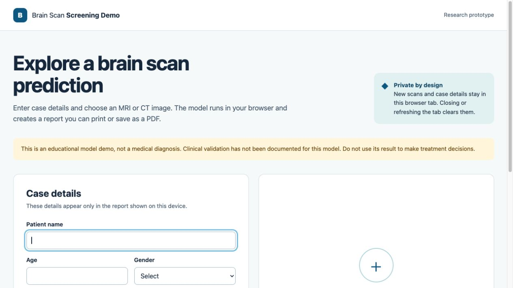
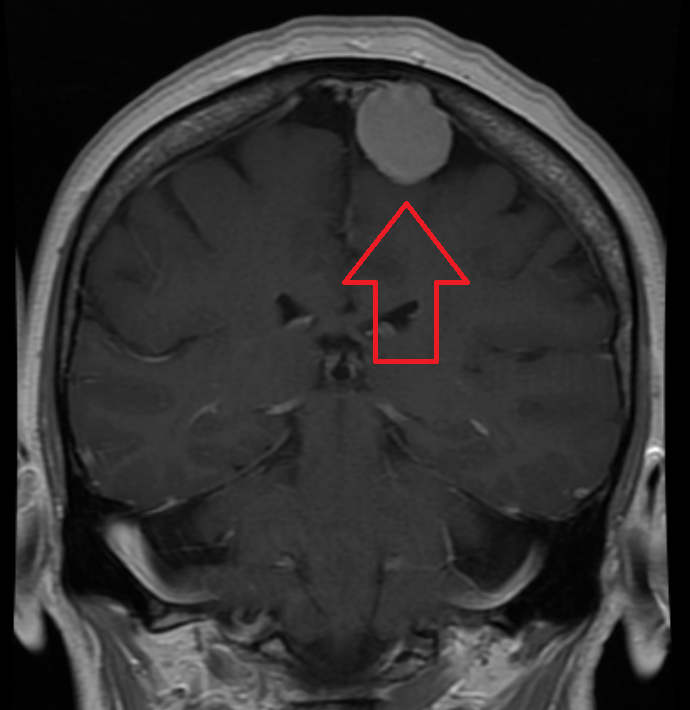
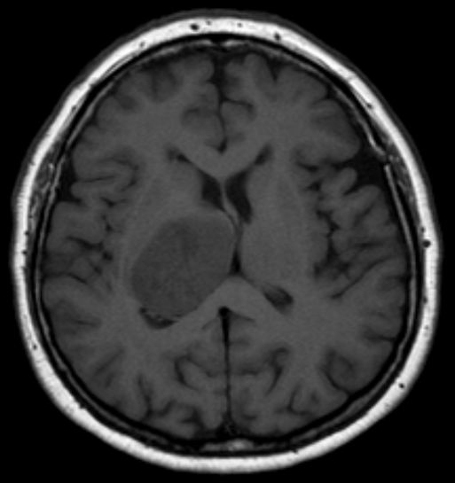
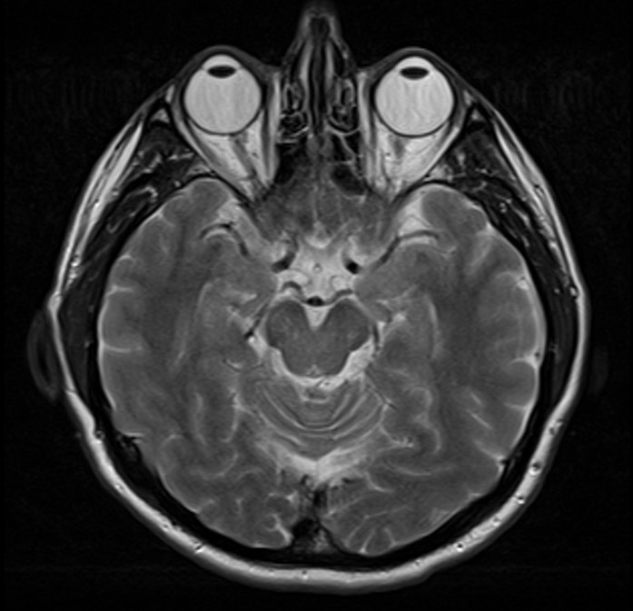

# Brain Scan Screening Demo

A public, browser-based demo of a two-class brain scan image model. Visitors can enter case details, select an MRI or CT image, view the model prediction, and print or save a report as a PDF.

**Live demo:** https://farhans-codes.github.io/brain_tumor_webapp/



> This is an educational research prototype. Clinical validation has not been documented for the model, and its output is not a diagnosis or a substitute for a qualified clinician.

## Privacy

The live app runs inference in the visitor's browser. Its JavaScript does not upload new scan images or case details, and the page's Content Security Policy limits network requests to its own origin. The report exists only in the current tab until the visitor prints or saves it. Refreshing or closing the tab clears the new case.

**Existing public files:** The repository already contained example scans and PDF reports with names in `legacy/static/uploads/` and `legacy/static/reports/`. They are retained at the owner's request and remain accessible through the public GitHub repository and its history. Do not put real patient data in this repository or use the demo with identifiable patient scans without appropriate consent.

## Use the demo

1. Open the live link above.
2. Enter case details and choose a PNG, JPEG, or WebP image up to 10 MB.
3. Select **Analyze scan**. The model predicts either **No tumor detected** or **Tumor detected** and displays its output score.
4. Use **Print / Save as PDF** to create a local copy, or **Clear this case** to remove the case from the page.

For a quick trial, select **Use this scan** on one of the example cards. The app fills only the image and MRI fields; enter fictional case details before analyzing.

The displayed model confidence is a raw model score. It is not a calibrated clinical probability. The model's training data, evaluation method, and clinical performance are not documented in the original project, so accuracy claims would be unsupported.

## Public MRI examples

These original images are included in `docs/examples/` for trying the browser workflow. Their source descriptions are independent of this model's predictions. The authors licensed them for reuse with attribution under Creative Commons ShareAlike; the files have not been altered.

| Source description | Preview | Credit and license |
| --- | --- | --- |
| Meningioma, coronal contrast MRI |  | [James Heilman, MD, CC BY-SA 4.0](https://commons.wikimedia.org/wiki/File:MRIMeningioma.png) |
| Glioblastoma, axial T1 MRI |  | [Hellerhoff, CC BY-SA 3.0](https://commons.wikimedia.org/wiki/File:Glioblastoma_multiforme_-_MRT_T1_ax.jpg) |
| Normal head and brain MRI |  | [Ptrump16, CC BY-SA 4.0](https://commons.wikimedia.org/wiki/File:MRI_Head_Brain_Normal.jpg) |

In a browser smoke check on the local site, the meningioma image returned **Tumor detected**, the normal MRI returned **No tumor detected**, and the source-confirmed glioblastoma image incorrectly returned **No tumor detected**. These three examples cannot establish accuracy or safety; the false negative is a concrete reason not to rely on the demo for clinical decisions.

## Run locally

Serve the `docs` directory over HTTP; opening `index.html` directly as a file will not load the model shards.

```bash
python3 -m http.server 8000 --directory docs
```

Open http://localhost:8000/. No build step, account, API key, backend, or database is required.

## Project layout

```text
docs/
  index.html            Accessible form and printable report
  examples/             Publicly licensed MRI teaching images
  media/                App screenshot for the README
  css/app.css           Responsive layout and visual tokens
  js/app.js             Form validation and workflow
  js/model.js           Model loading, preprocessing, and inference
  js/report.js          Safe report rendering
  model/                TensorFlow.js model and weight shards
  vendor/               Local TensorFlow.js runtime and license
legacy/                 Original Flask prototype, Keras model, and existing files
```

The live site is published only from `docs/`. The original Flask app is preserved under `legacy/` for reference; it is not used by the live demo and is not suitable for public deployment as written. Its login credentials are hardcoded, uploads and reports are saved under public static paths, and its report imitates a clinical document.

## Model conversion

`docs/model/` is a TensorFlow.js Layers model converted from `legacy/brain_tumor_model.h5`. The input is a 256 × 256 RGB image scaled to `[0, 1]`; the two softmax outputs map to **No tumor detected** and **Tumor detected**, matching the original Flask code. The converted model was checked against the original using the same synthetic tensor; the outputs matched within `1e-5`.

TensorFlow.js 4.22.0 is vendored locally under its Apache 2.0 license so that the app does not load third-party scripts. The source model's data provenance and license were not supplied in the original repository.

## Publishing

GitHub Pages can publish the `docs/` folder from the `main` branch. Once enabled, future pushes to `main` update the site automatically. The app uses relative asset paths, so it also works under the repository's project URL.
